# Web UI Tour

Every management capability of MiBee Steward ships inside its built-in web UI, embedded in the single Go binary, no separate frontend infrastructure required. This page walks through the interface area by area (screenshots show the light theme, captured from a live instance with sanitized demo data).

> The UI supports Chinese / English switching (language selector at the bottom of the sidebar) and light / dark themes. Screenshots below use the light theme.

## Login

The first visit to `http://<host>:8080` redirects to the login page. Sign in with the initial admin account (`admin` + the password from `auth.initial_admin_password`); TOTP two-factor authentication is supported, and user registration is admin-initiated.

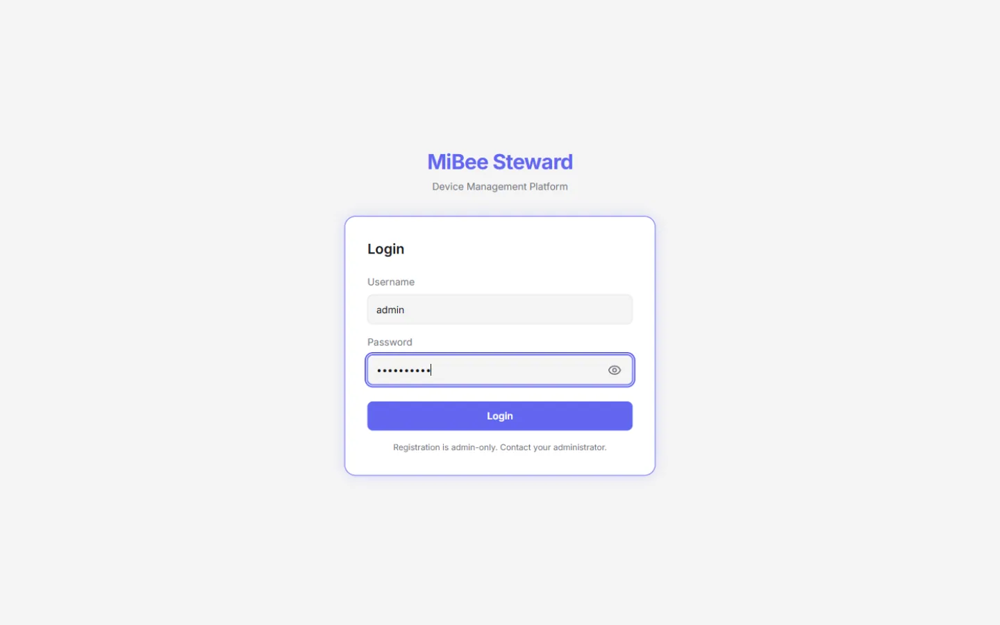

## Dashboard

The dashboard is the landing view: device status distribution, heartbeat success rate, device type distribution, and other widget cards; recent scan activity (alive / new / duration); and the offline devices that need attention. The widget layout is customizable (add/remove widgets), and a scan can be kicked off from the top-right corner.

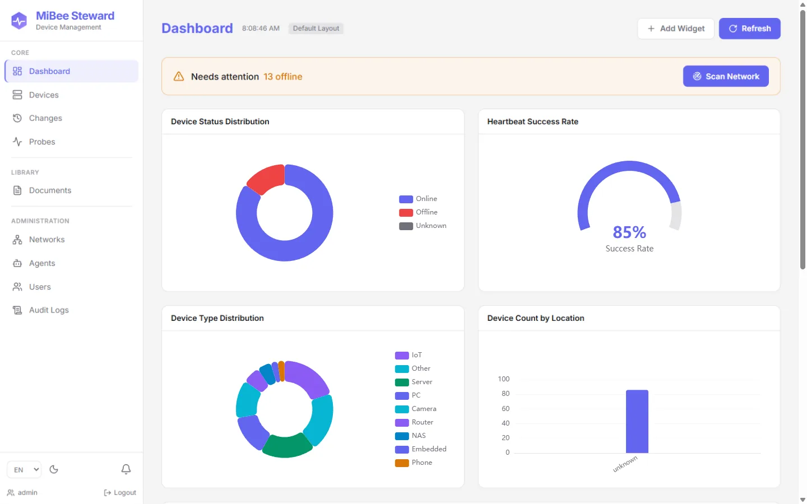

## Device Inventory

The device list is the day-to-day workhorse: every registered device across all networks, filterable by status/type, searchable, and sortable. Each row shows IP, MAC, OUI vendor, inferred type and brand, and online status; the identification source (protocol evidence vs hostname heuristic) is distinguished by a badge.

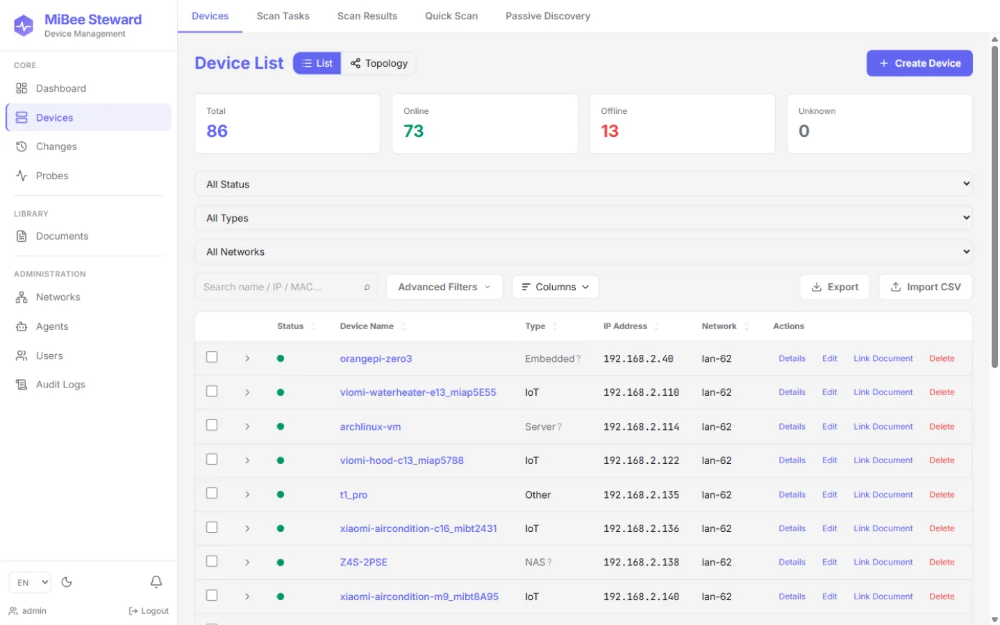

Click any device for the detail page: base info, scan attributes (SNMP sysName/description, open ports, detected services and versions), TLS certificates, heartbeat history, neighbor relationships, config backup versions, and attached documents, all on one page.

## Discovery & Identification

The Discovery page shows the identification funnel: discovery events received → suppressed/deduplicated → known-device skips → identification triggered → liveness confirmed → finally recorded into the inventory. The per-stage counters tell you how healthy your discovery sources are and how well the pipeline converts.

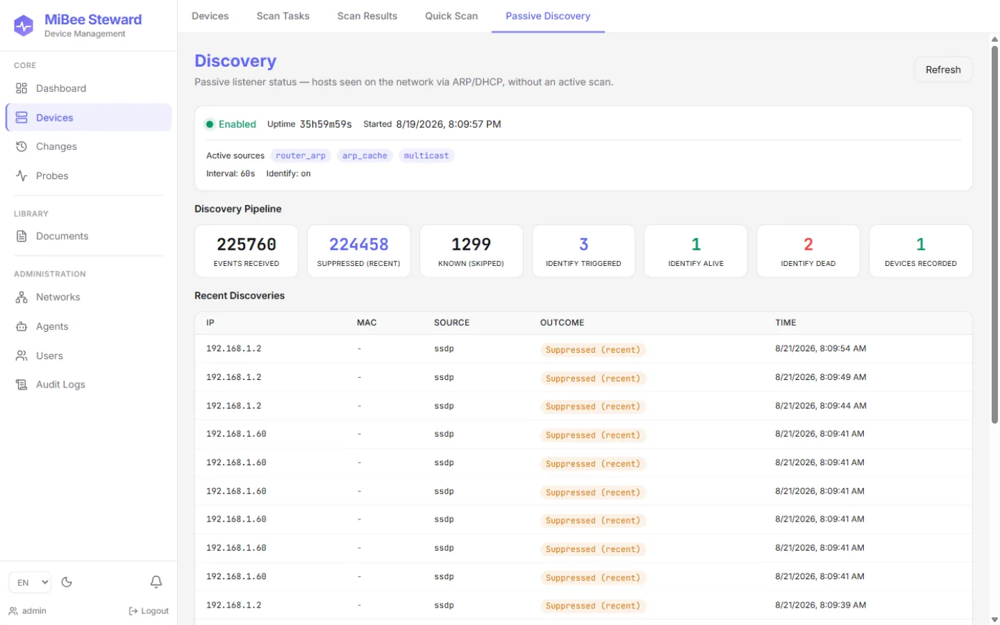

The Scanner page launches manual scans or manages recurring tasks: enter target CIDRs, SNMP community / v3 credentials, port and timeout parameters, then run a synchronous scan (≤1024 IPs) or create an async task (larger ranges). Results can be added back as devices.

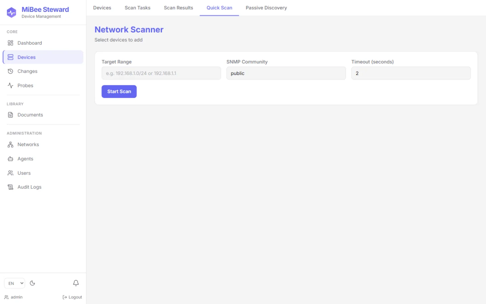

## Network Topology

For switched networks with LLDP / CDP / Bridge-MIB support, the topology page renders the device relationship graph automatically: core/distribution/access layers in distinct colors, edges carrying local/remote ports, VLAN tags, and STP roles; when a bridge's dot1dStp walk says which switch is the root bridge (#525), the graph roots on that collected fact instead of guessing by ARP in-degree; a device present in several segments (dual-NIC routers, the box bridging two LANs) wears a blue ring and a marker - the cross-segment link points (#556) - and its card lists each presence as segment · CIDR · address with the reporting vantage; the legend doubles as a layer filter, and clicking a node highlights its neighbors with a detail card.

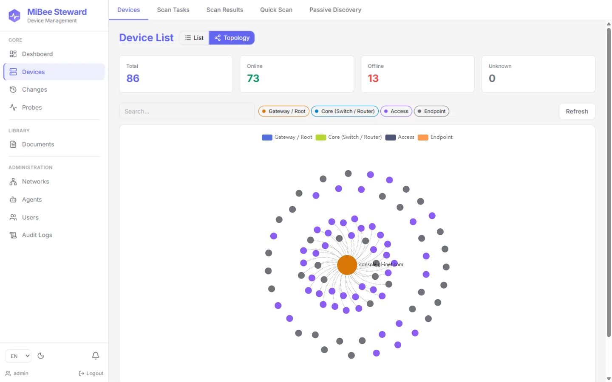

## Change Center

The Changes page lays out device additions / attribute changes / losses / config changes on a timeline, the "history axis" of the quasi-realtime network portrait. The SSE-based `/changes/watch` endpoint feeds downstream integrations.

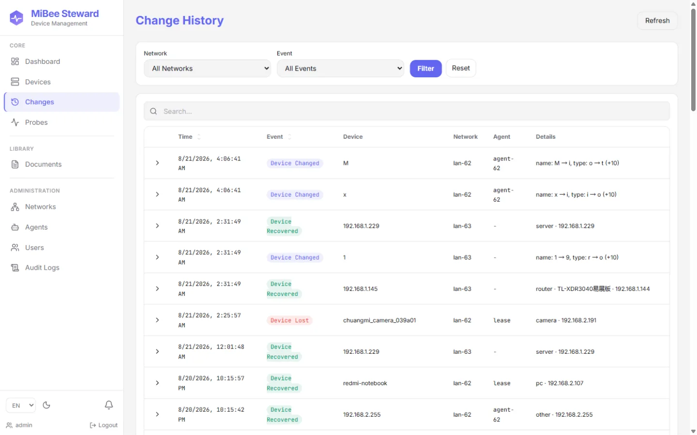

## Synthetic Probing

The Probes page manages periodic probing of targets **outside** your network: HTTP(S) availability, TLS certificate chains, TCP ports, ICMP liveness, and DNS resolution (`http` / `tls` / `tcp` / `icmp` / `dns` modules), plus full certificate-chain collection and expiry tracking for HTTPS sites. Each target has its own interval and, per module, an options form: http — method, expected status codes, body keyword (contains / not_contains / regex), ignore-TLS-errors; dns — record type, pinned resolver, expected IPs; tcp — send payload and banner expectation. Options never carry credentials or auth headers (the agent command channel stays secret-free by design).

Every target also declares its **vantage**, where its probes run from (the center itself, every registered agent, or one specific agent). The history dialog shows each vantage's latest result side by side and highlights when tracks disagree on success, the "reachable from A, not from B" view. See [Distributed](distributed.md#vantage-probing-277).

Targets carry a **source** badge — manual (yours), auto (generated from a discovered service, parked while that service is absent from scans), or system (the egress-quality matrix, managed by `probe.quality` config) — and may be bound to a device. The target list is grouped into three collapsible categories (#613), with the collapse state remembered per browser: **LAN probing** (device-bound targets), **external business probing** (manual, unbound), and **external quality probing** (the system matrix). The page also hosts the **quality** section, computed per the same categories (#613): LAN/external get simple window-health verdicts (ok / degraded / insufficient), while the quality category keeps the egress verdict chain (ok / degraded / egress down / DNS fault / upstream resolver) and scores over the built-in probe-point matrix, one column per network vantage, so "is this site down, or is MY egress broken" is answered at a glance. A small (?) help button next to the heading shows the computation formulas (window, ok-rate, p50, verdict chain, thresholds from `probe.quality`) on hover.

The page opens **health-first and collapsed** (second layout iteration): a summary bar answers "any problems right now" in one glance — the failing-target count (with a per-module breakdown and a one-click *Problems only* filter), the worst egress verdict per vantage as chips, and certificate expiry counts. Right below it sit the two drill-down panels as one-line collapsible headers (egress-quality matrices with window chips + the trend, and the certificate expiry timeline), then the target list whose three category sections are also collapsed by default — each header carries its count, a red failing badge when it has problems, and the enabled/ok/failing summary, so nothing is lost by staying folded. Search or a filter auto-expands the sections holding matches and folds them back when cleared. Expanding a section shows failing/timeout rows sorted to the top with an error tint, a failing track's error message right in the status cell, and an expandable troubleshoot row (click the target's name: per-vantage latest results, full error text, quick actions). The quality panel answers "over time" too: window chips (15m / 1h / 6h / 24h) widen the matrices' lookback, and inside it a collapsible **trend** (fetched lazily on first open) charts each group's per-vantage ok-rate over the last 7 days (hourly buckets) or 30 days (daily buckets) — the same verdict chain replayed per bucket, with a verdict-colored strip under the primary group; raw results are kept 30 days, so the trend starts wherever the data starts.

On the device detail page, the scan-discovery tab offers **one-click probe creation** per discovered service (pre-filled http/tcp target bound to the device), and a bound-targets panel lists every probe watching that asset; a service no longer present in the latest scan shows a read-only "not in latest scan" badge instead of the create button.

## Distributed Agents

Branch offices or isolated segments run `mibee-agent`, registering with the center via a one-time token. The Agents page shows each agent's online state, bound network, and last report; scan commands flow down the command channel, and agents poll, execute, and report back.

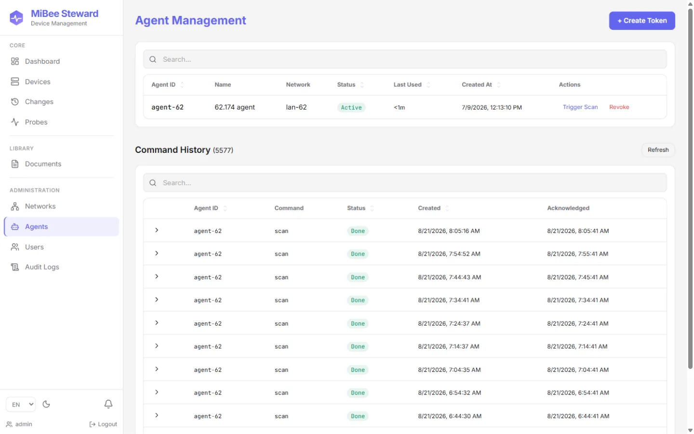

The Networks page manages logical networks (multi-LAN / multi-site): CIDR, site identifier, bound agent, and device count for each.

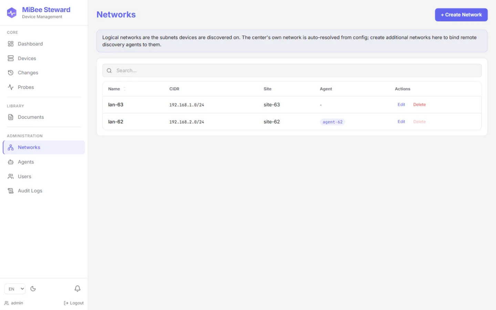

## Users & Permissions

Since v0.5.0 the UI uses a **role-capability model**: the `admin` / `operator` / `viewer` roles map to fine-grained capabilities (read devices, trigger scans, write configs, …), plus **object-level network grants**, non-admin users only see the networks they are granted (`closed` mode). The Users page handles account management and grant assignment.

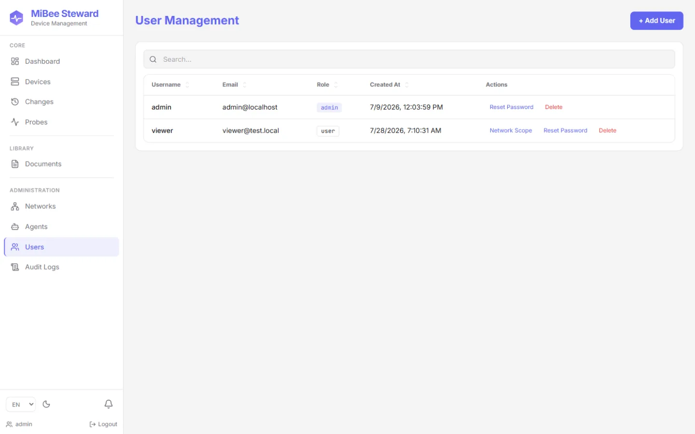

## Notifications & Integrations

The notification settings page manages two things: **channels** (webhook / email) and **rules** (which event, device lost/recovered/added/changed, config changed, goes to which channel, with a per-device cooldown). This is deliberately a thin rule→channel hop, not an alerting engine, alert orchestration stays with the Alertmanager ecosystem.

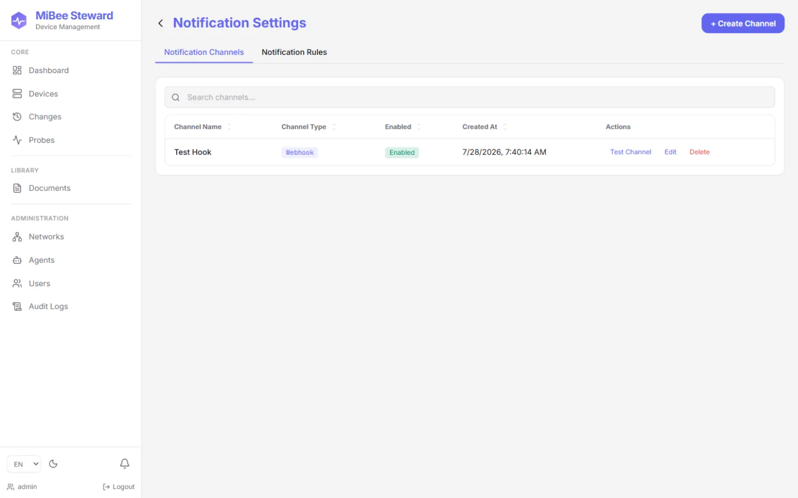

The settings page also covers profile, password change, TOTP two-factor, and theme/language preferences:

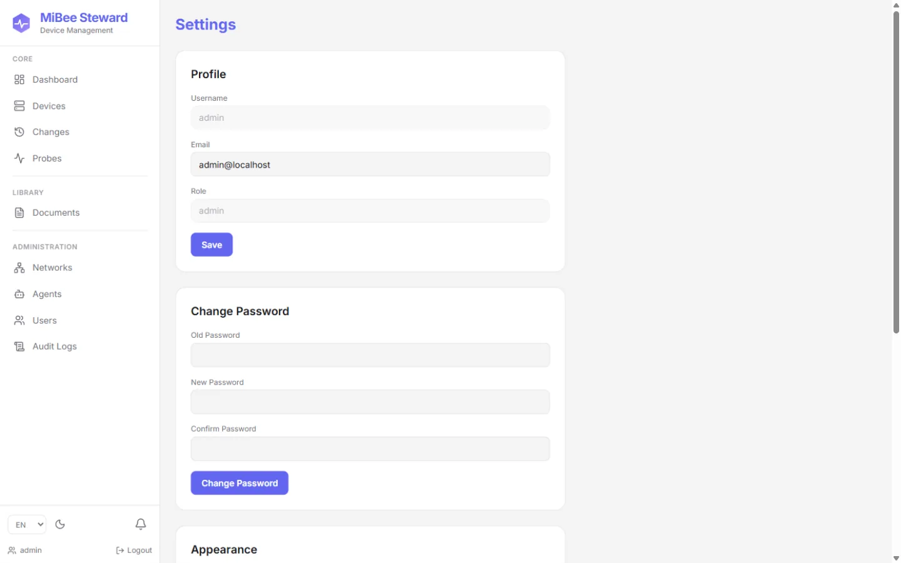

## Credential Vault

SNMPv3 (USM authNoPriv / authPriv) and SSH credentials live in the encrypted credential vault: AES-256-GCM at rest, keyed by `security.master_key`; the read API never echoes passphrases back (masked display only), and scans and config backups match credentials per target automatically.

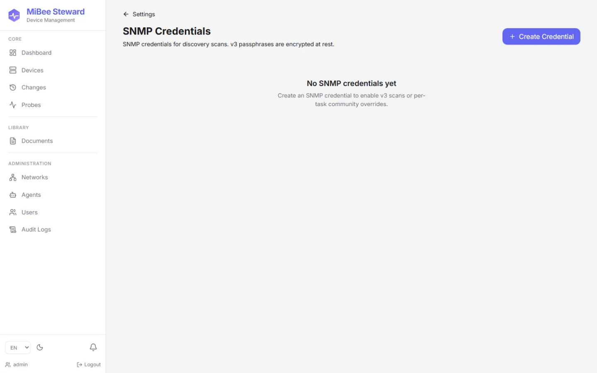

## Audit & Documents

The audit log records every sensitive operation (logins, credential changes, scan triggers, user management, …), the "who changed what, when" trail.

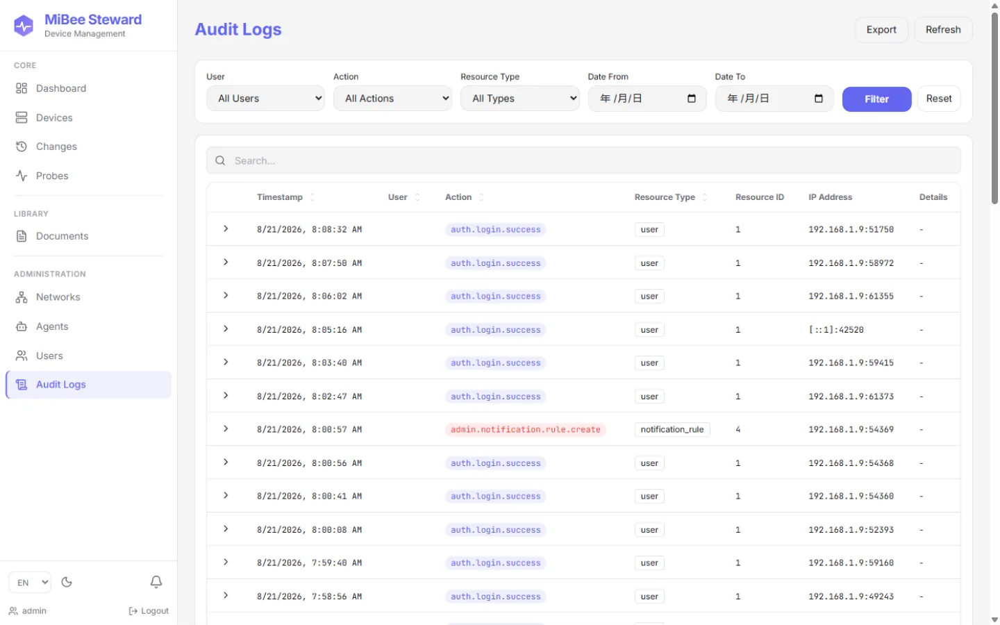

The document library attaches manuals, photos, and purchase records to devices (local upload, stored under `data/uploads`), extending the asset registry from "network visibility" into an "ops knowledge base".

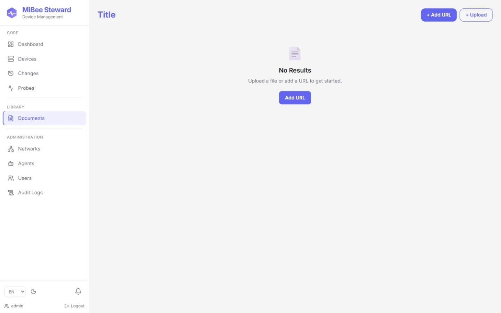

## Next Steps

- [Device Discovery & Identification](discovery.md), how probe sources, fingerprint rules, and the identification pipeline work
- [Distributed Deployment](distributed.md), the center + agent architecture in detail
- [Configuration Reference](configuration.md), every configuration key
