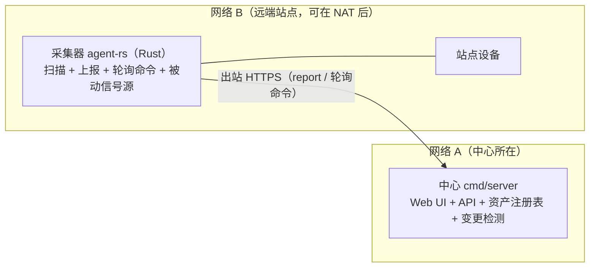
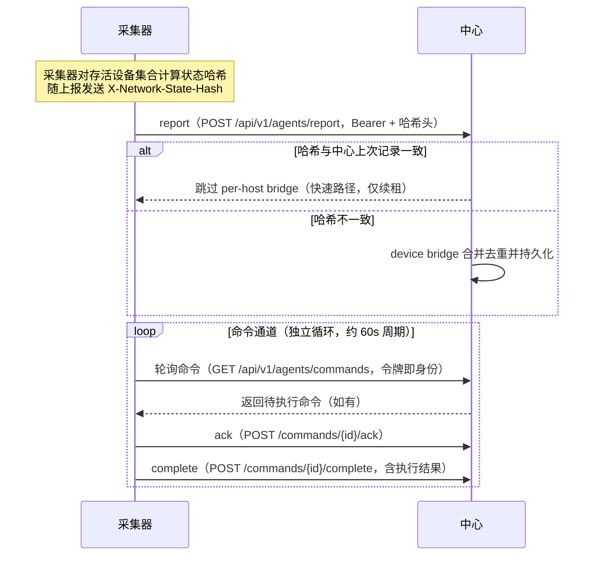

# 分布式部署

MiBee Steward 采用**中心 + 采集器**的分布式架构，跨多个局域网/站点统一管理资产。本文介绍架构、数据同步模型、命令通道与运维要点。

## 何时使用分布式

| 场景 | 规模 | 推荐 |
|---|---|---|
| 单局域网，几十台设备 | 小型 | 单机部署（见 [单机部署](deployment.md)） |
| 多个局域网 / 多站点 | 中大型 | **分布式**：一台中心 + 每站点一台采集器 |
| 路由器上已有发现需求 | 单/多 | 见 [OpenWrt 部署](openwrt.md)（形态 B 即分布式采集器） |

需要管理多个不相连的网段、或希望在各路由器上采集 Tier-1 信号（DHCP/conntrack/hostapd/dns_log）时，请使用分布式架构。

## 架构



中心是设备注册表的**唯一写入方（单写者持久化）**；采集器在各自网络中扫描，经 HTTPS 将结果上报给中心。采集器**只发起出站连接**（pull 模型），因此天然穿越 NAT/防火墙，无需在站点侧开放入站端口。


### 拉取模型时序



采集器由命令轮询器（轮询 / ack / complete）与上报器（上报，附带 `X-Network-State-Hash`）配对驱动，扫描执行与中心同源的 scannerv2 发现引擎（被动信号源从路由器就地采集）。两条通道相互独立：上报快慢不影响命令轮询。采集器即 Rust workspace `agent-rs/`——原 Go 采集器（`cmd/agent`）已于 2026-10-09 退役，完整对比与迁移须知见 [agent-rs.md](agent-rs.md)。

## 前置条件

- **中心**：一台可被采集器访问的服务器（域名或固定 IP，建议 HTTPS），运行中心二进制（`cmd/server`，~24MB，含嵌入式 SPA）。
- **采集器**：每站点一台（虚拟机 / 低功耗路由器均可），运行 Rust 采集器二进制（`agent-rs/` 的 `mibee-agent`，约 4.8MB 静态，无内置 UI，稳态内存约 12MB——见 [agent-rs.md](agent-rs.md)）。
- **时钟同步**：建议所有节点 NTP 对齐。采集器上报会按时间戳记录，NTP 能让"最近上报时间"更可读；令牌本身是不透明哈希查找、不校验时间，租约过期也只依赖中心自身时钟。

## Agent 安装与注册

### 1. 在中心上创建 Agent 令牌

Agent 令牌是中心签发的凭证，绑定 `network_id + agent_id`，不可跨网络复用。创建前需先在网络管理中建好目标网络（拿到**数字 ID**），然后在中心的 **Agents 页面**新建令牌，或直接调 API：

```bash
curl -s -X POST http://<center-ip>:8080/api/v1/agents/tokens \
  -H 'Authorization: Bearer <admin-token>' \
  -H 'Content-Type: application/json' \
  -d '{"agent_id":"agent-site-b","network_id":3,"name":"site-b"}'
```

- `agent_id`（必填，唯一，冲突返回 409）：采集器的身份标识
- `network_id`（必填）：目标 `networks` 行的**数字 ID**（不是网络名）
- `name`（可选）：备注名

令牌明文只在创建响应中返回一次，中心只保存 SHA-256 哈希。

### 2. 安装采集器

```bash
# 方式一：下载发布制品（静态 musl，带 tag 版本戳）
wget https://github.com/Mi-Bee-Studio/MiBeeSteward/releases/download/<tag>/mibee-agent-linux-arm64
chmod +x mibee-agent-linux-arm64
sudo mv mibee-agent-linux-arm64 /usr/local/bin/mibee-agent

# 方式二：本地构建（aarch64 / armv7 musl；需要 cargo-zigbuild +
# ziglang pip 包——见 agent-rs/README.md）
make build-agent-rs
cp agent-rs/target/aarch64-unknown-linux-musl/release/mibee-agent /usr/local/bin/mibee-agent
```

### 3. 配置并启动

```bash
sudo mkdir -p /etc/mibee
sudo tee /etc/mibee/agent.yaml > /dev/null <<'EOF'
center:
  url: "https://<center-domain>"
  auth_token: "<上一步创建的令牌>"
  report_interval: "30s"
network:
  name: "site-b"
  cidr: "192.168.20.0/24"
EOF

sudo mibee-agent -config /etc/mibee/agent.yaml
```

可选：用 systemd 常驻（仓库 `deploy/mibee-agent.service` 提供 unit 模板）。

> **重要**：采集器**不会仅凭上述配置自行开始扫描**--它只执行本地 `scan_tasks` 中登记的扫描任务和中心下发的命令。让它动起来的三种方式：
> 1. 在中心的 Agents 页面对该采集器下发一次 `scan` 命令（最常用）；
> 2. 在采集器本地数据库中插入 `scan_tasks` 行（适合固化周期扫描）；
> 3. 启用 `scanner.discovery.*` 被动发现源（路由器侧信号，见 [OpenWrt 部署](openwrt.md)）。
>
> 命令轮询在启动后立即开始（约 60s 周期），首次上报则发生在第一次扫描/发现产出结果之后（默认每 30s 刷新一次，`center.report_interval`）。

## 数据同步模型

### Report → Device Bridge（设备桥）

采集器将扫描结果通过 `POST /api/v1/agents/report` 上报到中心，附带 `X-Network-State-Hash` 请求头。中心是设备注册表的唯一写入方（单写者持久化）。

**哈希由采集器计算**（对存活设备集合的"身份+分类"字段排序后取 SHA-256），中心只与上次收到的值比较：

- **哈希匹配** → 中心跳过完整的 per-host bridge，仅刷新租约（快速路径，节省 CPU 与 DB 写入）。注意该"上次哈希"存于中心内存，中心重启后会回到完整合并一次。
- **哈希不匹配** → 走完整合并：按 MAC 去重、保留跨上报稳定的设备 ID、更新在线状态，并触发**变更事件**。

变更事件通过 SSE（`/api/v1/changes/watch`）实时推送给订阅者（Web UI、通知等），实现跨网络资产视图的准实时刷新。

### 租约与状态

| 参数 | 默认值 | 说明 |
|---|---|---|
| 设备租约 TTL | 5 分钟（`scanner.agent_lease_ttl`） | 采集器上报续租；中心后台 `LeaseSweeper`（默认 60s 扫一次）检测超时并标记离线 |
| 上报刷新周期 | 30 秒（`center.report_interval`） | 有新扫描结果时按此节奏刷新上报；连续错过约 10 次即超出租约 TTL |
| 命令轮询周期 | ~60 秒 | 独立于上报通道 |
| 待重试上报队列 | 内存 100 批 | 断连期间缓存**上报**（非命令），恢复后补齐；超出即丢弃最旧批次 |

## 命令通道

中心可以主动向采集器下发命令（例如触发一次临时扫描）：

1. 管理员调用 `POST /api/v1/agents/{agentId}/commands` 入队命令（命令保存在中心的 `agent_commands` 表）。
2. 采集器的 `command_poller` 以约 60 秒周期轮询 `GET /api/v1/agents/commands` 取回--路径中**没有** agentId，令牌即身份。
3. 采集器执行后先调 `POST /api/v1/agents/commands/{id}/ack` 确认接收，再调 `POST /api/v1/agents/commands/{id}/complete` 上报结果（`{"status":"done|failed","result":...}`）--complete 是即时 HTTP 调用，不随下一次上报捎带。

命令是**尽力而为**的：采集器离线期间入队的命令不会过期，恢复连接后在下个轮询周期执行。


### Agent 网络的定时扫描任务

`scan_tasks` 原生支持 agent 管理的网络：任务目标落在某个 agent 网络(该 `networks` 行绑有 `agent_id`)的 CIDR 内时，调度器在每个 cron 周期**直接向该 agent 下发扫描命令**（复用命令通道与目标校验），而不是在中心本地扫描，agent 网络的扫描器就是 agent 本身。下发成功记一条 `completed` 运行记录；下发被拒（目标越界等）记 `failed` 并附原因，任务运行历史直接可见。扫描结果照常经 `/agents/report` 回流（设备桥接、租约、变更检测不变）。

> 历史注记：该能力之前靠部署侧的 systemd timer + 硬编码密码的 shell 脚本驱动（登录 → 调命令 API）。脚本在密码轮换后静默失败，还会周期性烧毁 admin 的失败登录计数、反复续锁账户。内部调度落地后此类外部脚本应全部退役，改密码不再有隐藏的消费方。

### Agent 侧 SNMP 凭据（#241）

agent 可通过**本地凭据库**探测远端局域网内的 SNMPv3（USM auth/priv）设备，凭据存在 agent 自己的 mini-DB 的 `snmp_credentials` 表中，用 **agent 自己的** `security.master_key` 做 AES-256-GCM 加密。该密钥与中心的 master key 刻意相互独立：单台 agent 主机失陷只暴露该 agent 的凭据，不触及中心金库（反之亦然）。凭据材料永远不会经过 agent↔中心 通道。

在 agent 主机上配置：

```bash
# 1. agent.yaml 里配 32 字节 master key（或 MIBEE_SECURITY_MASTER_KEY 环境变量）：
#    security:
#      master_key: "<恰好 32 字节>"

# 2. 写入凭据（口令输入顺序：flag > 环境变量 > stdin 提示）：
mibee-agent snmp-credential -config /etc/mibee/agent.yaml -action add \
  -name switch-v3 -security-level authPriv -username snmpadmin \
  -auth-protocol SHA -priv-protocol AES
mibee-agent snmp-credential -config /etc/mibee/agent.yaml -action list
mibee-agent snmp-credential -config /etc/mibee/agent.yaml -action remove -name switch-v3

# 3. 重启 agent 让 resolver 加载金库。
```

两条绑定路径：

- **本地扫描任务**：直接给 agent 的 `scan_tasks` 行设 `credential_id`（本地金库 ID）--调度器原样传入引擎。
- **中心下发的任务**：中心侧绑定了凭据的 `scan_tasks` 行下发时在 scan payload 中携带 `credential_name`；agent 用**名字**在自己的金库里解析（两侧 ID 各自独立，名字才是跨系统键）。给 agent 侧凭据起与中心相同的名字即可。

降级语义统一：未配 master key、名字不存在、ID 失效，一律回退到 agent 全局 `scanner.snmp_community` 并记警告，金库配错不会导致扫描失败。

### 多视角拨测（#277）

拨测目标通过 `vantage` 字段声明**从哪里执行**--同一个端点从不同网络发起，答案可能合法地不同：

- `center`（默认）：中心本机执行--原有的单视角行为。
- `agent:{agent_id}`：指定 agent 执行；中心拒绝在本地跑此类目标（手动触发返回 409 `ErrProbeVantageNotLocal`）。
- `all`：中心与所有已注册 agent 各跑一条轨道。

调度器经命令通道向每个 agent 下发其探测计划（按指纹去重，稳态零命令流量）；`all` 计划按 agent 分别盖章，结果落入各自轨道。agent 用与中心**相同的执行语义**跑探测，批量 POST 到 `POST /api/v1/agents/probe-report`--agent token 认证，且上报者的身份会覆盖 payload 里声称的任何 vantage（agent 永远只能写自己的轨道）。

**能力协商（#604）**：每个 agent 声明自己的拨测模块集（上报 meta 里的 `supported_modules`，中心记入 `agent_status`），调度器据此过滤计划--agent 永远不会收到它无法执行的目标。未声明能力的旧 agent（≤0.1.x）按 `{icmp, http, tls}` 假定，tcp/dns 计划会被扣留并在中心日志打一次性升级提示：0.2.0 之前的 agent 收到 tcp 计划只会以「unknown module」失败（一个真实 bug），调度器选择先挡住、而不是放任目标变红。**tcp 或 dns 的 vantage 目标要求 mibee-agent 0.2.0+**--该版本同时带来：http 探测默认校验 TLS（旧 agent 接受任意证书；`ignore_tls_errors` 是按目标的显式豁免）、icmp/tls 支持主机名（系统解析器）、真实 webpki-roots 信任判定、失败上报批次进有界重试队列而非丢弃、以及首次运行的确定性错峰。

中心侧结果按 `(target, vantage)` 维度入库。拨测页全程按视角展示：目标表单提供视角选择器；目标列表按轨道逐行显示状态（列表/详情响应的 `vantage_latest`，agent-only 目标的 `last_*` 只由中心写、不会更新，agent 结果靠它才可见），轨道间成功与否不一致时高亮；历史弹窗默认图表页签（各轨道延迟折线，失败断线；agent 轨道用虚线和独立符号，与 center 重叠时仍可分辨），下方状态色块时间线带成功率，原始明细保留在独立页签。全部 `mibee_probe_*` 指标带 `vantage` 标签。不做调度强一致：agent 离线只是停止为其轨道贡献样本。

## 舰队管理（#278）

每份 agent 上报都携带元信息块，构建版本、Go 版本、主机名、进程运行时长、累计上报批次数，中心将其连同**时钟偏移**近似值（上报时间戳与接收时间之差）写入 `agent_status` 表。**Agents 页面**展示这些舰队遥测：每个 agent 的版本、时钟偏移（超过 ±60s 高亮）、最后上报时间，与既有 token 状态并列。

### 远程运维

命令通道还承载一个运维命令族，`restart` / `config-reload` / `logs-tail`，作用于 agent **进程**而非网络：

- **双重门控**：中心侧未开启 `agent_fleet.remote_ops_enabled: true` 时拒绝入队，agent 自身未开启 `center.remote_ops_enabled: true` 时拒绝执行。任一侧都能阻止运维命令。
- 每次成功入队都有**审计日志**（`agent.ops_command`，含操作用户）。
- `restart` / `config-reload` 重执行 agent 二进制（配置在构造时消费，重执行是唯一忠实的重载）。`logs-tail` 返回 agent 内存环形缓冲中最近 ≤50 行日志，结果落在 Agents 页的命令历史里。
- 在 systemd/procd 下重执行即干净重启；裸 shell 会话下进程以相同参数回来。

### 指纹语料分发

agent 无需任何二进制或包更新即可与中心保持指纹语料一致（`center.fingerprint_sync.enabled`，默认关闭）：

- agent 携带上次应用的版本号轮询 `GET /api/v1/agents/fingerprints`（`interval`，默认 10m）；`204` 表示无变化，`200` 返回中心当前语料的确定性 tar.gz 包 —— 中心配置了 `scanner.fingerprint_path` 目录时以目录为准（在其中编辑/投放 YAML，全舰队下次轮询即生效，**中心无需重启**），否则返回中心二进制内嵌语料（因此每次中心升级都会自动传播到全舰队）。
- 每个语料包在替换本地语料前先经规则引擎自身的加载器校验：加载失败（或加载出零规则）的语料直接丢弃，agent 继续运行原语料 —— 不重启、不会崩溃循环。
- 校验通过后语料原子落盘（agent 配置旁的 `fingerprints-sync/` 目录），agent 重执行以激活。重启带限频（5 分钟）：目录抖动至多每个窗口扰动舰队一次，连续变更会合并收敛到最新语料。
- 引擎加载语料的优先级：`scanner.fingerprint_path`（运维指定目录）→ 同步目录 → 内嵌语料。
- 已应用版本号持久化在同步目录旁、启动时打日志，并随每次上报的舰队元数据携带——中心的"设置 → 指纹库"页用一张表展示全舰队语料采纳状态（最新/落后/未上报）。

## 运维

### 监控

- 中心健康：`curl http://<center-ip>:8080/api/v1/health`。
- 采集器状态：中心 Web UI 的 **Agents 页面**可看到每个令牌的最近使用时间（≈最近上报/轮询，5 分钟内有活动即显示 Active）与命令历史。
- 日志：采集器 `journalctl -u mibee-agent -f`；中心同样用 systemd 管理。

### 断连与恢复

- 采集器断网：出站连接失败即退避重试，不产生错误风暴；内存中的待重试队列（100 批）缓存上报，恢复后补齐。
- 中心重启：SQLite 单写者，冷启动安全；采集器自动继续上报（中心的哈希缓存清空，会完整合并一次后恢复快速路径）。
- 令牌空窗 / 吊销：401 的含义是"中心**此刻**不认识这个令牌"——既可能是主动吊销，也可能是合法运维中的换库空窗（中心重建后原令牌即将恢复，agent-rs 0.1.7，#554）。采集器会把该批上报压入待重试队列、仅丢弃空心跳，之后每个 5 分钟冷却窗口重试一次直到令牌重新可用；期间本地扫描与被动发现照常运行。对永久吊销的令牌，代价也只是每个窗口一次探测请求。其余 4xx（400/403/409）仍为终结性：该批丢弃并记日志，重新签发令牌并更新 `center.auth_token` 后立即恢复。

### 限制

- 中心为**单实例**设计（SQLite 单写者），不支持多中心写同一注册表。
- 命令通道是拉取式，无法做到毫秒级即时下发（轮询周期 ~60 秒）。
- 采集器本地 DB 只是影子，权威数据始终在中心。

## 只读联邦（#379）

两个 center 可以互为镜像：每个 center 完整管理**自己的网段**（断联时本地 UI、数据库、扫描节奏照常自治），同时持有一份对端设备的准实时**镜像**——仅列表与详情画像。其余一切（拨测、文档、TLS 证书链、配置备份、凭据、原始 evidence、命令通道）既不共享也不暴露：wire 协议本来就不携带，且对端永远无法向本网段派发扫描/拨测/重启。

搭建全用既有积木：

1. 在对端：为你的网段建 networks 行（POST /networks）并铸造 peer token（POST /agents/tokens 指定该网络）——铸造即给该网段打上 `agent_id`，标记为外部管理。
2. 在你这边：配置 `peer.*` 块（center_url、auth_token；agent_id 默认 `peer-<主机名>`，cidr 默认 network.cidr）。

此后你的扫描与被动发现经与 Rust agent 完全相同的上报通道流向对端（反熵状态哈希、租约活性、变更事件全继承），对端设备带着网段标签出现在你这一侧。

**网段来源只读围栏**双向守护：所在网段 `agent_id` 非空的设备（分布式 agent 或联邦对端）都是镜像——所有变更路由（设备编辑/删除、批量操作、systems、文档、心跳配置）一律 403，本地 admin 也不例外。手改反正会被下一波上报覆盖；UI 直接隐藏动作按钮并显示"远端网段"徽标。该围栏同时补上了纯 center+agent 架构里的同一个坑。

语义：peer 链路断开时对端租约过期（设备在对端标 lost）、恢复后自愈；镜像设备的变更事件**会**进入本端变更日志（这正是准实时感知的载体）。跨网段拓扑链接点为二期候选（#526 的多归属在场事实是地基）。

**镜像新鲜度（#557）**：agent/peer 管理的网段，其数据只随 owning agent 的最近上报而新鲜——networks 列表每行携带 `agent_last_used_at` 与派生的 `agent_stale`（5 分钟窗口，与 Agents 页 Active 口径一致）。owner 停止上报后，UI 把中性的"远端"徽标换成琥珀色的"远端 · 过期"（悬停显示最近上报时间）、淡化该网段设备行、并在网段筛选旁给出提示；网段管理页对每个 agent 网段显示最近上报。恢复是自动的——纯派生自 token 的最近使用时间，不落任何状态。普通分布式 agent 与联邦 peer 一视同仁（peer 的内嵌上报器本身就是一台 agent）。

**跨网段桥接（#556）**：同时在多个网段在场的设备（#526 的多归属在场事实）就是连接两段的链接点。拓扑图对这类节点打标（蓝色描边 + 标签记号，工具栏有计数），节点卡的每条在场记录显示为 `网段 · CIDR · 地址` 并附上报视角，不再是裸行号。

## 相关页面

- [单机部署](deployment.md)，无需分布式的单网络场景
- [OpenWrt 部署](openwrt.md)，形态 B 即分布式采集器的路由器形态
- [配置参考](configuration.md)，采集器与中心的全部配置项
