# Web 界面巡礼

MiBee Steward 的全部管理功能都通过内置 Web 界面完成--它被嵌入在单个 Go 二进制里，部署即得，无需额外的前端设施。本页按功能区域逐一走一遍界面（截图均为浅色主题，取自真实运行实例，演示数据已脱敏）。

> 界面支持中文 / English 一键切换（侧栏底部语言选择器）与浅色 / 深色主题，以下截图均为浅色主题。

## 登录

首次访问 `http://<host>:8080` 会重定向到登录页。使用初始管理员账号（`admin` + 配置文件中 `auth.initial_admin_password` 指定的密码）登录；支持 TOTP 两步验证，普通用户的注册仅管理员可发起。

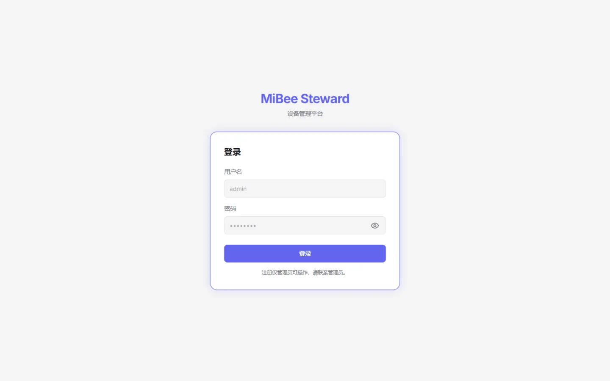

## 仪表盘

登录后首先看到仪表盘：设备状态分布、心跳成功率、设备类型分布等组件化卡片，最近的扫描活动（存活/新增/耗时），以及需要关注的离线设备清单。组件布局可自定义（添加/移除组件），右上角可一键发起扫描。

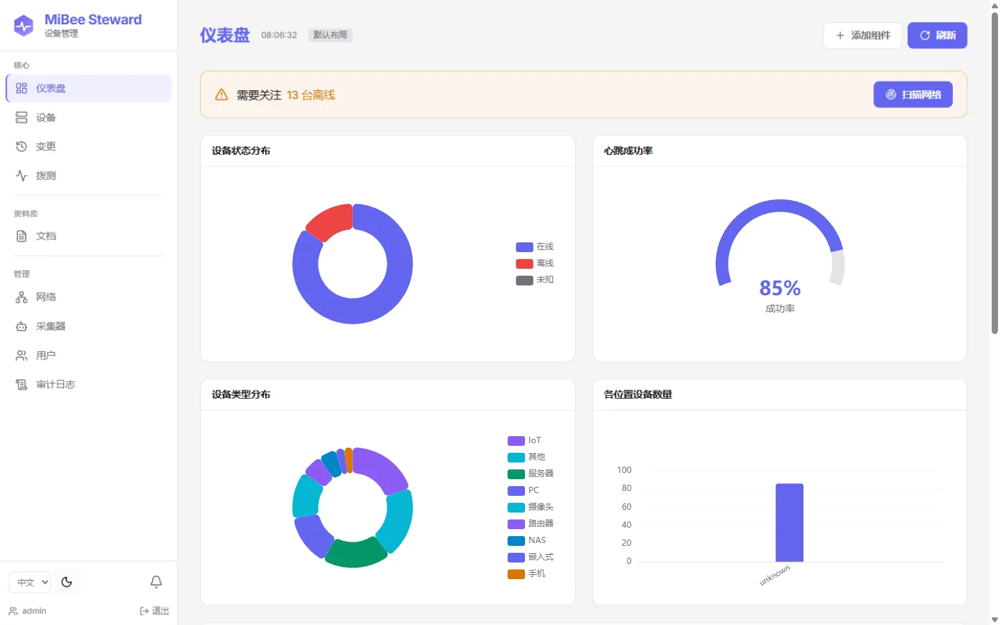

## 设备资产

设备列表是日常工作的主界面：跨网络聚合展示所有已登记设备，支持按状态/类型筛选、关键字搜索与排序。每行展示 IP、MAC、OUI 厂商、识别出的类型与品牌、在线状态；识别来源（协议证据 vs 主名启发式）会以角标区分。

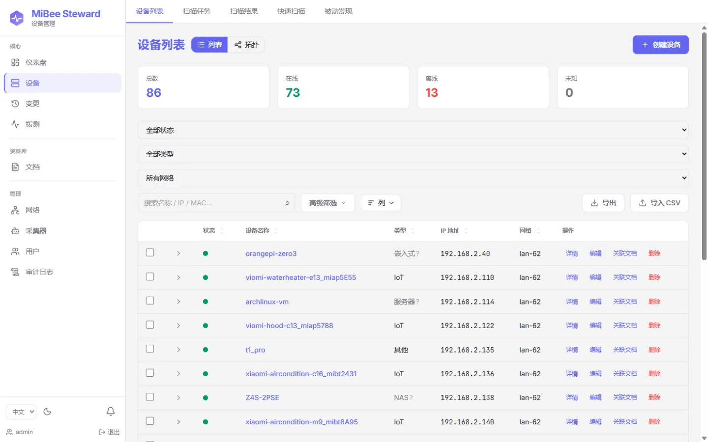

点击任意设备进入详情页：基础信息、扫描属性（SNMP sysName/描述、开放端口、检测到的服务与版本）、TLS 证书、心跳历史、邻居关系、配置备份版本与关联文档，全部集中在一页。

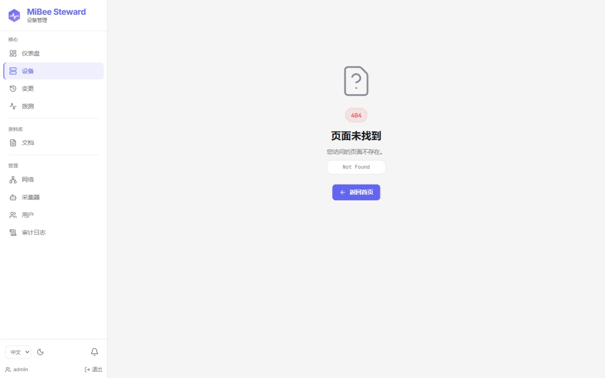

## 发现与识别

「发现」页展示识别漏斗：接收到的发现事件 → 抑制/去重 → 已知设备跳过 → 触发识别 → 存活确认 → 最终登记入资产库。漏斗各级计数用于评估发现源的健康度与识别管线的转化率。

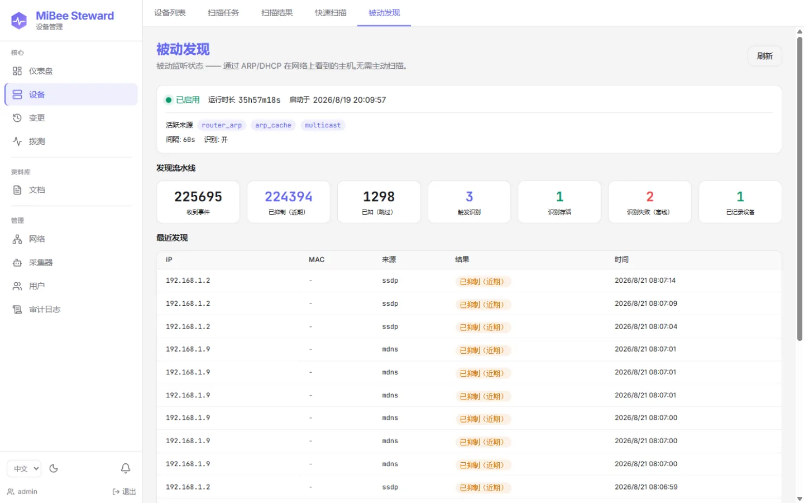

「扫描器」页发起手动扫描或管理周期任务：填写目标 CIDR、SNMP community / v3 凭据、端口与超时参数，即可同步扫描（≤1024 IP）或创建异步任务（更大网段）。扫描结果可回填为设备。

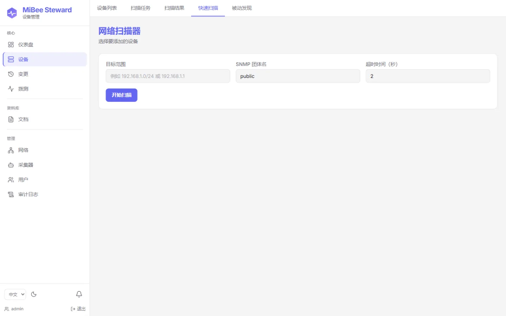

## 网络拓扑

对支持 LLDP / CDP / Bridge-MIB 的交换网络，拓扑页自动生成设备关系图：核心/汇聚/接入分层着色，边携带本地/远端端口、VLAN 标签与 STP 角色；当某台网桥的 dot1dStp 采集指明了根桥（#525），图以该采集事实定根，而不再按 ARP 入度猜测；同时活跃在多个网段的设备（双网卡路由器、桥接两段 LAN 的主机）带蓝色描边与记号——跨网段链接点（#556）——其卡片把每条在场记录显示为 网段 · CIDR · 地址 并附上报视角；图例可按层过滤，点击节点高亮邻居并展示详情。

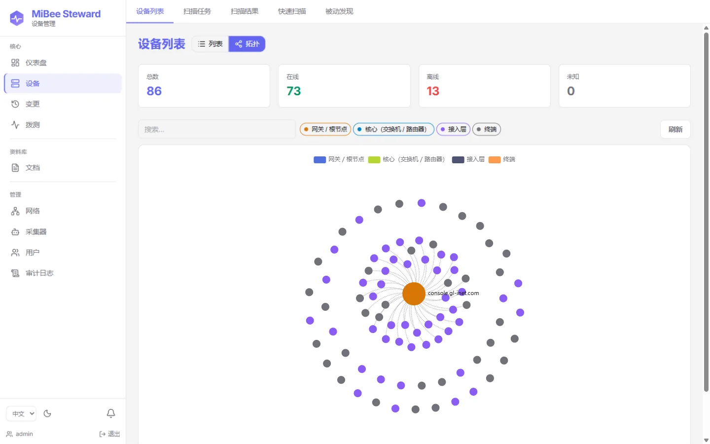

## 变更中心

变更页按时间线展示设备的增加 / 属性变化 / 失联 / 配置变更事件，是准实时网络画像的"时间轴视图"；基于 SSE 的 `/changes/watch` 为下游集成提供事件流。

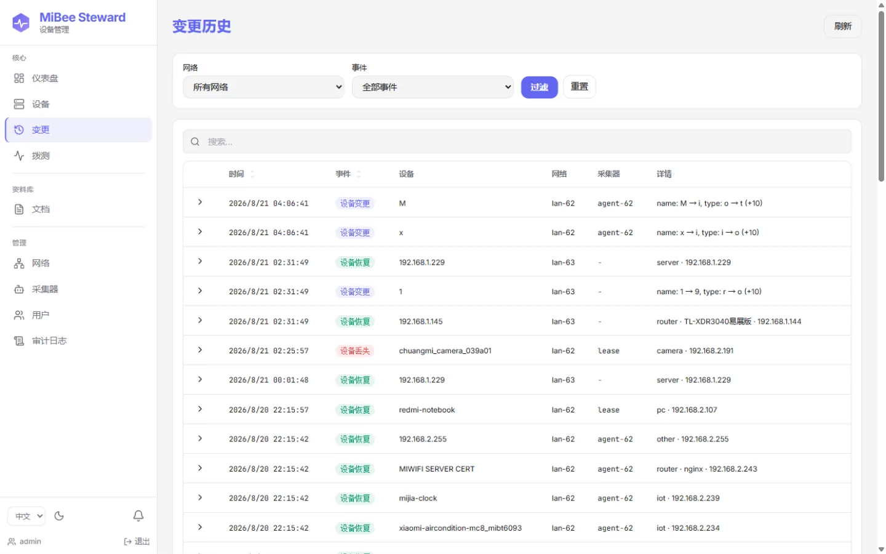

## 拨测（外网资源探测）

拨测页管理对**网络外**目标的周期性探测：HTTP(S) 可用性、TLS 证书链、TCP 端口、ICMP 存活与 DNS 解析（`http` / `tls` / `tcp` / `icmp` / `dns` 五种模块），以及对 HTTPS 站点的完整证书链采集与到期跟踪。每条目标可独立设置探测间隔，并按模块填写选项表单：http--方法、期望状态码、正文关键字（contains / not_contains / regex）、忽略 TLS 错误；dns--记录类型、指定解析器、期望 IP；tcp--发送载荷与 banner 期望。选项永远不携带凭据或认证头（agent 命令通道必须保持无密钥，这是设计保证）。

每条目标还声明自己的**探测视角**（vantage）--探测从哪里发起（中心本机、所有已注册 agent、或指定 agent）。历史弹窗并排展示各视角最新结果，轨道对成功与否不一致时高亮--「A 处通 / B 处不通」的排障视图。见[分布式](distributed.md#多视角拨测277)。

目标带**来源**徽章--manual（手工创建）、auto（由发现的服务自动生成，服务从扫描中消失时挂起）、system（出口质量矩阵，由 `probe.quality` 配置管理）--并可以绑定到设备。目标列表按三类分组折叠展示（#613），折叠状态按浏览器记忆：**内网拨测**（绑定设备的目标）、**外网业务拨测**（手动未绑定）、**外网质量探测**（系统矩阵）。页面还承载**质量**区块，按同样的分类计算（#613）：内网/外网业务为简单窗口健康判定（ok / degraded / insufficient），外网质量类别保留出口判定链（ok / degraded / 出口中断 / DNS 故障 / 上游解析器）与分数，基于内置拨测点矩阵、每个网络视角一列，「是站点挂了，还是我的出口坏了」一眼可判。标题旁有一个 (?) 帮助小按钮，鼠标悬停展示计算公式说明（窗口、成功率、p50、判定链、阈值来自 `probe.quality` 配置）。

页面按**健康优先、默认收起**组织（第二轮布局迭代）：顶部总览条一眼回答「现在有没有问题」——异常目标数（附按模块细分与一键「只看异常」过滤）、每个网络视角的最差出口判定徽章、证书临期计数。紧随其后的两个下钻面板折叠为一行标题（出口质量矩阵含窗口胶囊与趋势、证书到期时间线），再往下是目标列表的三个分区——同样默认收起，每个表头带计数、异常时的红色徽章与「启用/正常/异常」汇总，收起也不丢失信号；搜索或过滤命中时相应分区自动展开、清除后自动收回。展开分区后，失败/超时行置顶并带异常底色，失败轨道把错误信息直接印在状态格里，点击目标名称展开排障行（各视角最新结果、完整错误文本、快捷操作）。质量面板同时回答「随时间怎么样」：窗口胶囊（15分钟 / 1小时 / 6小时 / 24小时）放宽矩阵的回看范围；面板内的**趋势**子折叠块（首次展开才拉取数据）以折线图展示各组各视角最近 7 天（小时桶）/ 30 天（天桶）的成功率走势——同一条判定链按桶回放，主组下方还有按判定着色的色带；原始结果保留 30 天，趋势从数据实际起点开始。

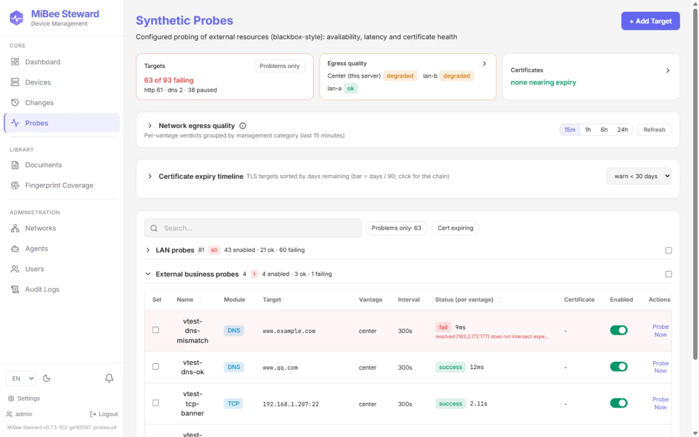

设备详情页的扫描发现标签页对每个发现的服务提供**一键创建拨测**（预填 http/tcp 目标并绑定该设备），绑定目标面板列出盯守该资产的所有拨测；不再出现在最新扫描里的服务显示只读的「不在最新扫描中」徽章，代替创建按钮。

## 分布式采集器

分支机构或隔离网段可部署 `mibee-agent`，通过一次性令牌向中心注册。采集器页展示各 agent 的在线状态、归属网络与最近上报；扫描指令经命令通道下发，agent 拉取执行后回传结果。

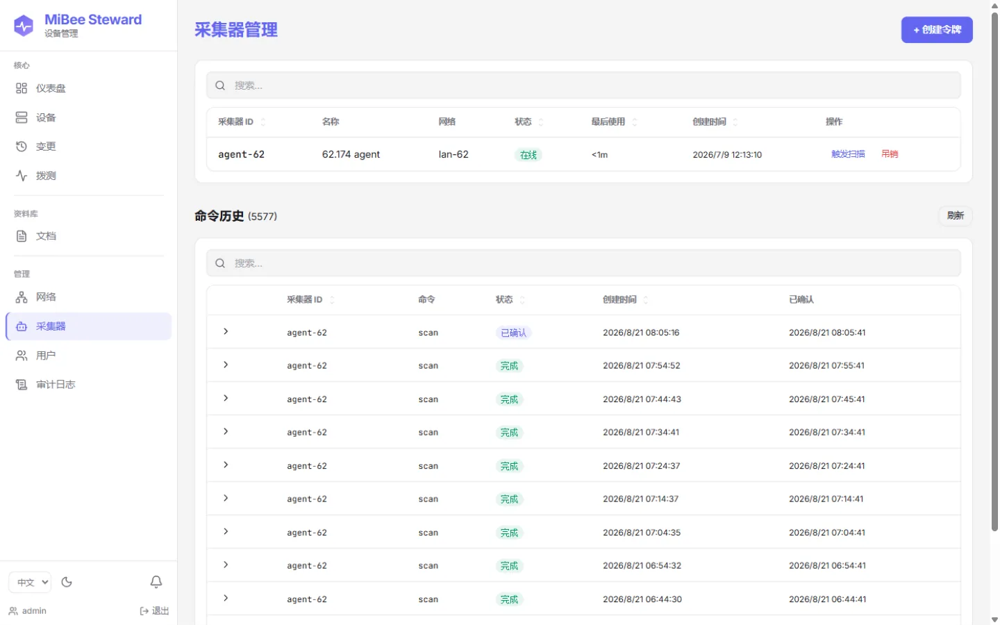

网络页管理逻辑网络（多 LAN / 多站点）：每个网络的 CIDR、站点标识、绑定的采集器与设备数量。

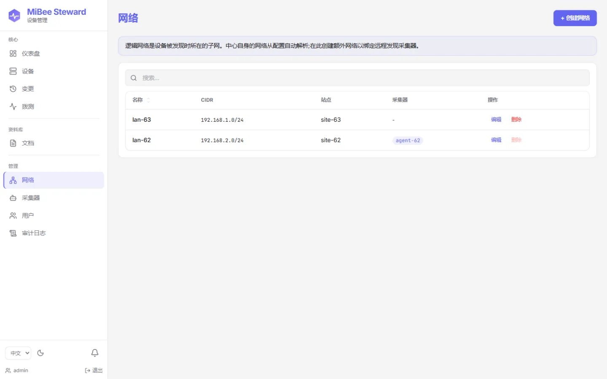

## 用户与权限

v0.5.0 起采用**角色-能力模型**：`admin` / `operator` / `viewer` 三种角色映射到细粒度能力（读设备、触发扫描、写配置……），并支持**按网络的对象级授权**--非管理员用户只能看到被授权的网络（`closed` 模式）。用户页完成账号管理与授权分配。

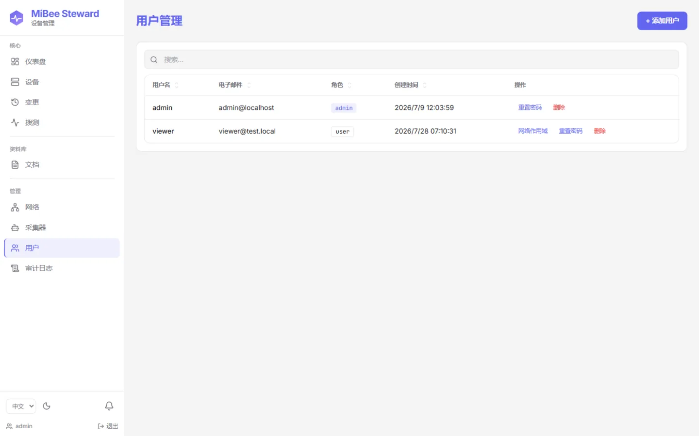

## 通知与集成

设置中的通知页管理两件事：**渠道**（webhook / 邮件）与**规则**（哪种事件--设备失联/恢复/新增/变更/配置变更--发到哪个渠道，附带每设备防抖冷却）。这是刻意保持轻量的"规则→渠道"转发，不是告警引擎--告警编排仍交给 Alertmanager 生态。

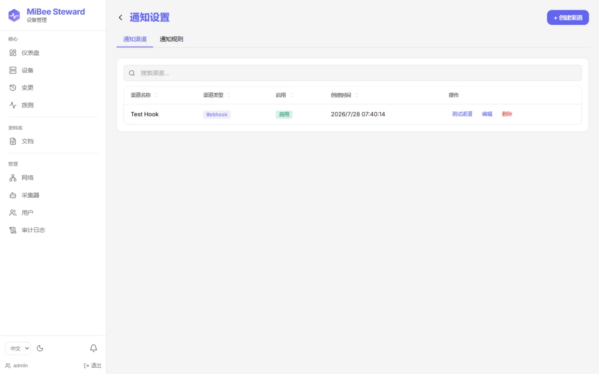

设置页还包含个人资料、密码修改、TOTP 两步验证、主题与语言偏好：

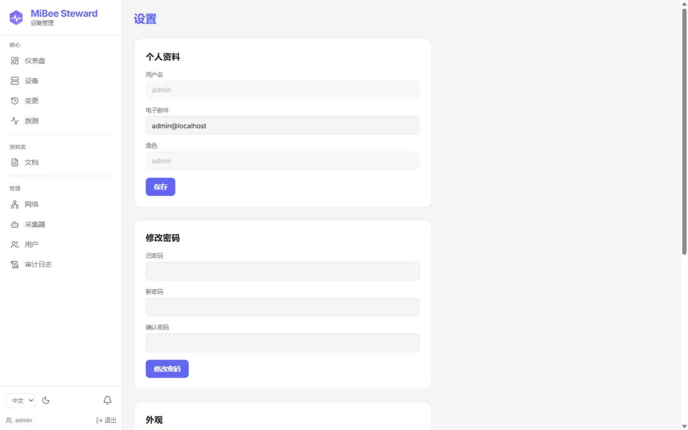

## 凭据库

SNMPv3（USM authNoPriv / authPriv）与 SSH 凭据集中存放在加密凭据库中：AES-256-GCM 静态加密，密钥来自 `security.master_key`；读取接口永不回显口令（仅显示掩码），扫描与配置备份按目标自动匹配凭据。

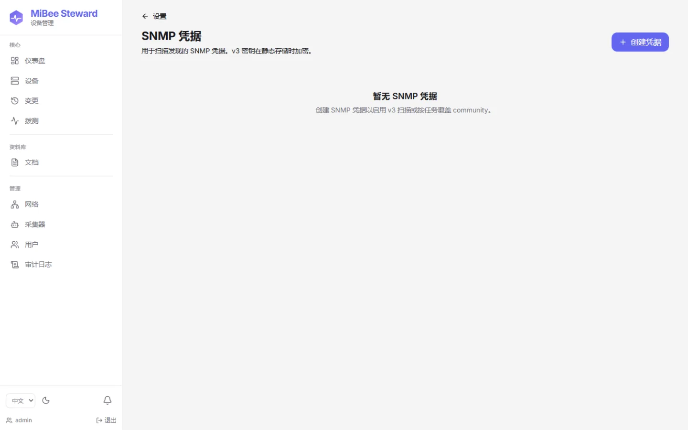

## 审计与文档

审计日志记录所有敏感操作（登录、凭据变更、扫描触发、用户管理……），满足"谁在什么时候改了什么"的追溯需求。

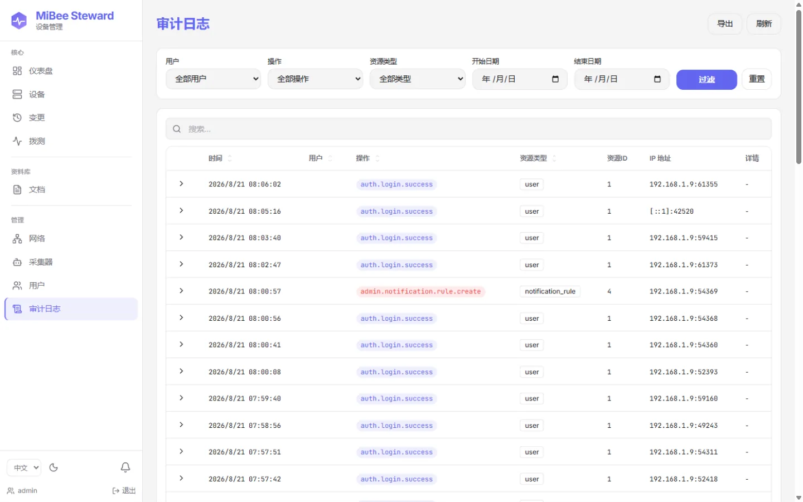

文档库为设备挂载手册、照片、采购凭证等附件（本地上传，`data/uploads` 存储），让资产台账从"网络可见性"延伸到"运维知识库"。

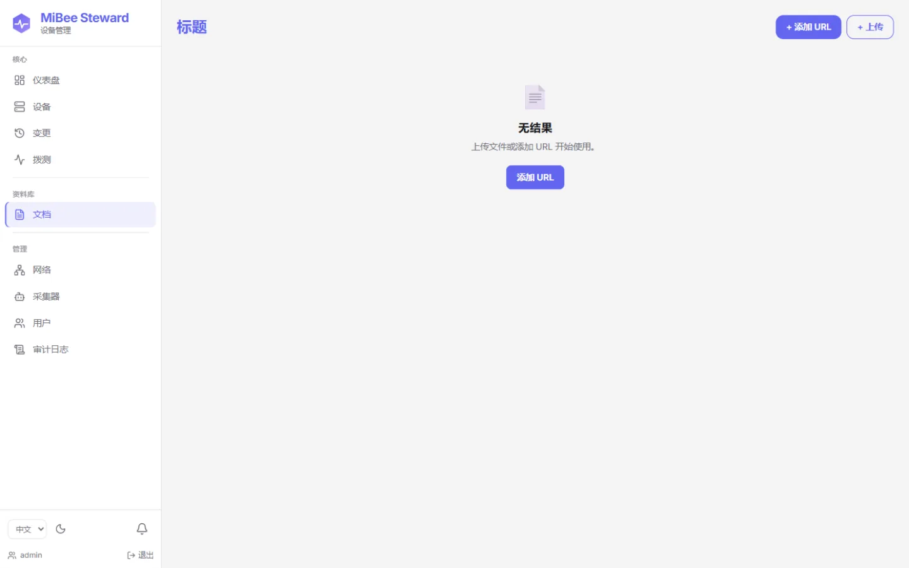

## 下一步

- [设备发现与识别](discovery.md)--探测源、指纹规则与识别管线的工作原理
- [分布式部署](distributed.md)--中心 + 采集器的架构细节
- [配置参考](configuration.md)--全部配置项
